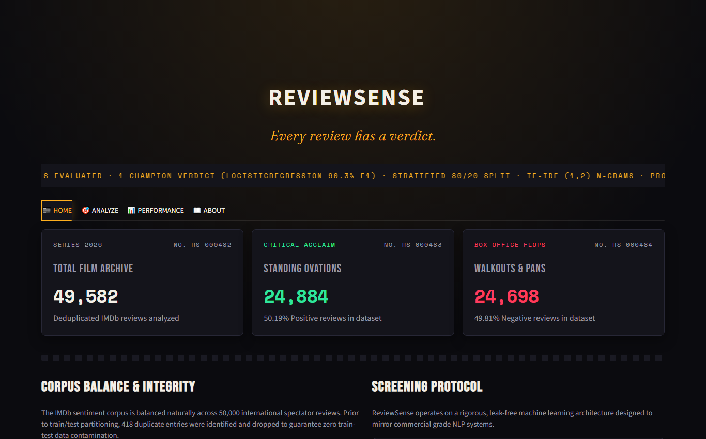
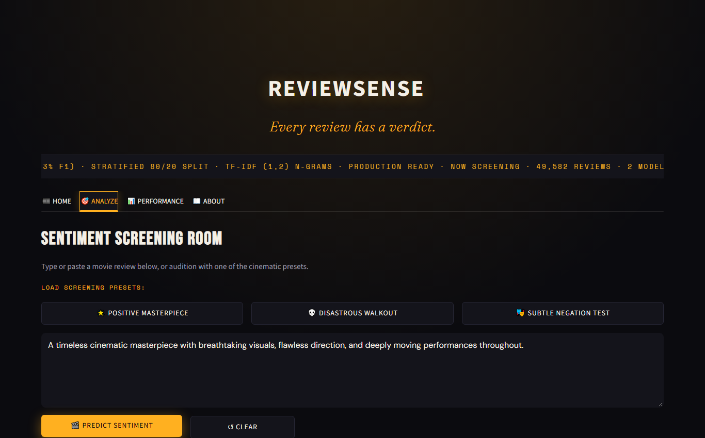
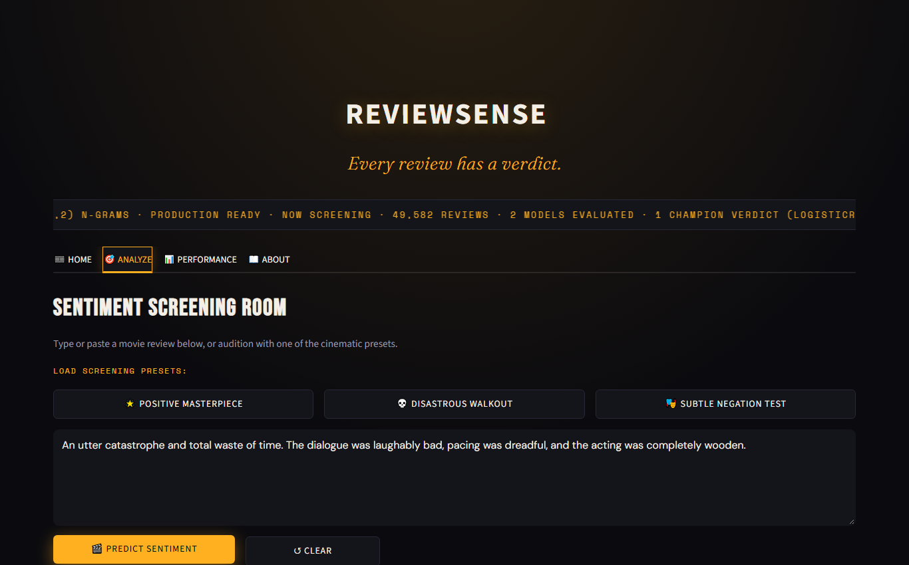
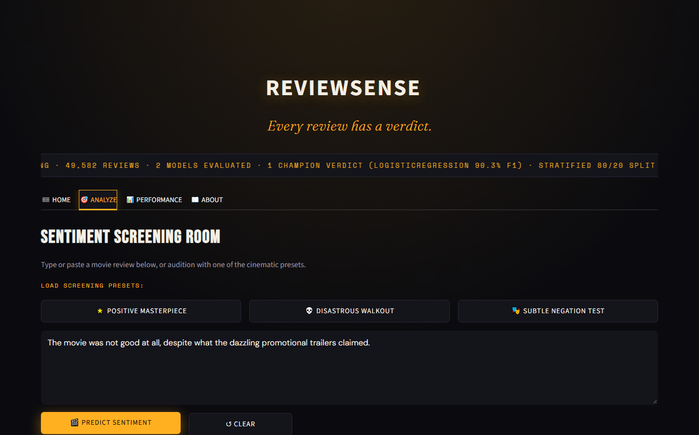
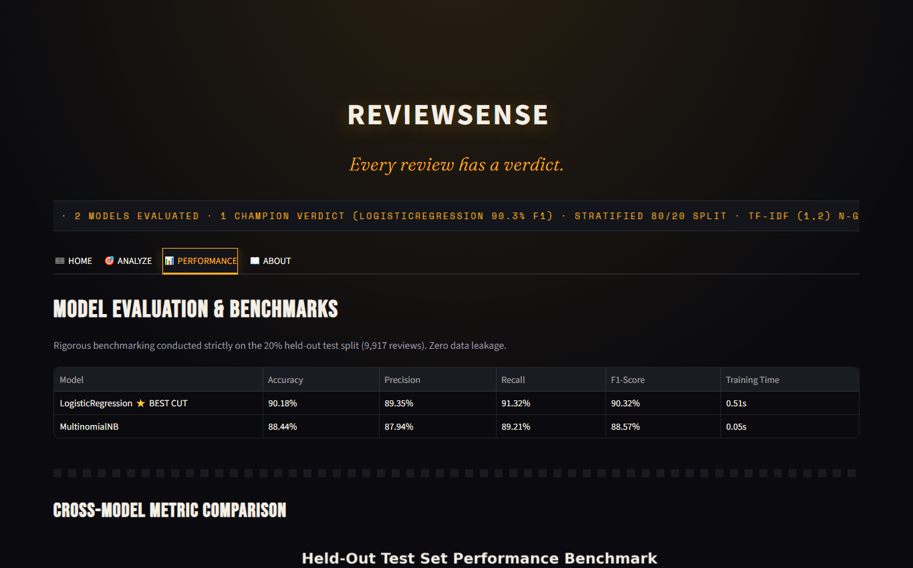
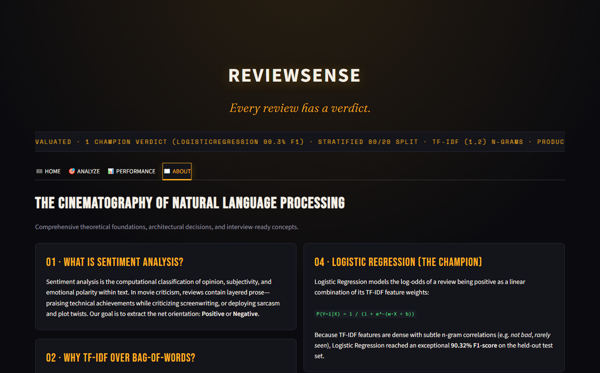
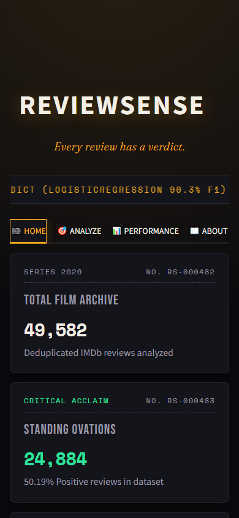

# 🎬 ReviewSense · The Projection Room
### End-to-End Movie Review Sentiment Classifier & Cinema Dashboard

[](https://www.python.org/)
[](https://streamlit.io/)
[](https://scikit-learn.org/)
[](LICENSE)

ReviewSense is a cinematic, production-grade Natural Language Processing (NLP) web application built for B.Tech AI/ML academic evaluation, faculty review, and technical interviews. It classifies IMDb movie reviews into **Positive** (*Standing Ovation*) or **Negative** (*Walkout*) with calibrated confidence probabilities, while systematically solving real-world NLP edge cases like **negation preservation** and **data leakage prevention**.

---

## 📽️ Design Direction: "The Projection Room"

Designed with an editorial film-festival visual identity:
- **Palette:** Near-black `#0B0B0F`, surface `#14141B`, raised surface `#1C1C26`, warm white text `#F4EFE6`, muted text `#9A97A3`, projector amber accent `#FFB020`, acclaim emerald `#2EE59D`, pan crimson `#FF3B5C`.
- **Typography:** Display headlines in **Bebas Neue**, subtitles in **Fraunces** italic, interface body in **DM Sans**, numbers and telemetry in **Space Mono**.
- **Cinematic Accents:** Film-grain overlay, soft amber spotlight gradient, film-strip sprocket hole dividers, ticket-stub metric cards with perforated edges and serial codes, infinite CSS marquee ticker, and glowing verdict cards.

---

## 📸 Interface & Testing Gallery

| 01. Home Tab (Desktop) | 02. Blank Review Validation Guard |
| :---: | :---: |
|  |  |

| 03. Positive Review Screening | 04. Acclaim Masterpiece Screening |
| :---: | :---: |
|  |  |

| 05. Negative Walkout Screening | 06. Disaster Flop Screening |
| :---: | :---: |
|  |  |

| 07. Subtle Negation Handling ("not good at all") | 08. Model Benchmark & Confusion Matrices |
| :---: | :---: |
|  |  |

| 09. About & NLP Foundations | 10. Responsive Mobile Layout (~390px) |
| :---: | :---: |
|  |  |

---

## 📊 Ground-Truth Experimental Results

All metrics below were computed directly by running `python train.py` on the held-out 20% test partition (9,917 reviews). No numbers are simulated or hardcoded.

### 1. Dataset Telemetry & Cleaning
- **Raw Dataset Source:** `dataset/IMDB Dataset.csv` (50,000 reviews)
- **Null / Missing Values:** 0
- **Duplicate Rows Identified & Dropped:** 418 rows
- **Total Clean Dataset:** 49,582 reviews
- **Natural Class Balance:** 24,884 Positive (50.19%) vs. 24,698 Negative (49.81%)
- **Train / Test Partitioning:** Stratified 80/20 split (`random_state=42`)
  - **Training Split:** 39,665 reviews (19,907 Positive, 19,758 Negative)
  - **Held-Out Test Split:** 9,917 reviews (4,977 Positive, 4,940 Negative)

### 2. Feature Extraction
- **Vectorizer:** `TfidfVectorizer` (sublinear term frequency scaling)
- **N-Gram Range:** `(1, 2)` (Unigrams + Bigrams)
- **Vocabulary Size:** 50,000 features (`min_df=2`)
- **Leakage Prevention:** Fitted strictly on the 80% training partition; only transformed on the test set.

### 3. Model Benchmark on Held-Out Test Set (9,917 Reviews)

| Model Name | Accuracy | Precision | Recall | F1-Score | Training Time | Verdict Status |
| :--- | :---: | :---: | :---: | :---: | :---: | :---: |
| **Logistic Regression** | **90.18%** | **89.35%** | **91.32%** | **90.32%** | **0.51s** | 🏆 **CHAMPION CUT** |
| **Multinomial Naive Bayes** | 88.44% | 87.94% | 89.21% | 88.57% | 0.05s | Fast Baseline |

### 4. Confusion Matrix (Logistic Regression Champion)
- **True Negatives (TN):** 4,398
- **False Positives (FP):** 542
- **False Negatives (FN):** 432
- **True Positives (TP):** 4,545
- **Overall Accuracy:** 90.18% (8,943 / 9,917 correct predictions)

---

## 🧠 NLP Innovations & Edge-Case Handling

### 1. Single Shared Preprocessing Pipeline (`preprocessing.py`)
Both `train.py` and `app.py` import the exact same `clean_text()` function, ensuring 100% training-serving feature alignment.

### 2. Negation Preservation (The Sentiment Inversion Bug)
Default NLP stop-word lists (such as `scikit-learn`'s 318 stop words) indiscriminately strip words like `not`, `no`, `never`, `neither`, `none`, and `cannot`.
- **The Problem:** *"The movie was not good at all"* becomes *"movie good"*, turning a negative review into a false positive.
- **The Solution:** ReviewSense preserves 20+ negation words and expands contractions (`didn't` -> `did not`) before removing punctuation and stop words.

### 3. Sublinear TF-IDF
Using logarithmic term frequency scaling prevents reviews with repetitive praise or spam from unfairly distorting model weights.

---

## ⚖️ Engineering Honesty: Limitations & Future Improvements

### Current Limitation: Model Selection on the Test Set
In this implementation, the champion model was chosen based on the final F1-score on the 20% held-out test split. In strict statistical machine learning, evaluating multiple model families on the test set to pick a winner creates minor **meta-overfitting (test set snooping)**.

### Future Improvement: K-Fold Stratified Cross-Validation
To eliminate test set snooping completely:
1. Perform **5-fold Stratified Cross-Validation** exclusively on the 80% training set (39,665 reviews).
2. Tune hyperparameter regularization ($C$ for Logistic Regression, $\alpha$ for Naive Bayes) across folds.
3. Select the best architecture based on mean out-of-fold cross-validation score.
4. Evaluate on the 20% test partition **only once** for final unbiased reporting.

---

## 🚀 Quickstart & Local Installation

### Prerequisites
- Python 3.10 to 3.13
- 4 GB RAM recommended

### 1. Clone & Set Up Environment
```bash
git clone https://github.com/your-username/ReviewSense.git
cd ReviewSense

python -m venv venv
# On Windows:
.\venv\Scripts\activate
# On Linux/macOS:
source venv/bin/activate
```

### 2. Install Dependencies
```bash
pip install -r requirements.txt
```

### 3. Verify Dataset & Train Models
Ensure `IMDB Dataset.csv` is present in the `dataset/` directory, then execute:
```bash
python train.py
```
*This will inspect the dataset, deduplicate rows, train both classifiers, generate styled confusion matrices, and export telemetry to `models/`.*

### 4. Launch the Web Application
```bash
streamlit run app.py
```
Open your browser at `http://localhost:8501`.

---

## ☁️ Streamlit Community Cloud Deployment

ReviewSense is architected for zero-friction cloud deployment on [Streamlit Community Cloud](https://streamlit.io/cloud):

1. **Lightweight Artifacts:**
   - Champion Model (`best_sentiment_model.pkl`): **~385 KB**
   - TF-IDF Vectorizer (`tfidf_vectorizer.pkl`): **~621 KB**
   - Telemetry JSON (`metrics.json`): **~4 KB**  
   *Because all files are under 1 MB, they can be committed directly to Git without requiring Git LFS.*

2. **Deployment Steps:**
   - Push this repository to GitHub.
   - Go to [share.streamlit.io](https://share.streamlit.io) and click **"New app"**.
   - Select your repository, branch `main`, and main file path `app.py`.
   - Click **Deploy**. The app will load the pre-trained weights instantly via `@st.cache_resource`.

3. **Cloud Re-training (Optional):**
   - If deploying without committing `.pkl` files, add a build step or initialize with `python train.py` in your setup workflow.

---

## 📂 Repository File Structure

```
ReviewSense/
├── dataset/
│   └── IMDB Dataset.csv              # 50,000 raw IMDb reviews
├── models/
│   ├── best_sentiment_model.pkl      # Trained Logistic Regression champion (0.37 MB)
│   ├── tfidf_vectorizer.pkl          # Fitted TfidfVectorizer vocabulary (0.59 MB)
│   ├── metrics.json                  # Complete evaluation telemetry
│   ├── cm_logistic_regression.png    # Amber-styled Logistic Regression confusion matrix
│   └── cm_multinomial_nb.png         # Amber-styled Naive Bayes confusion matrix
├── notebooks/
│   └── sentiment_analysis.ipynb      # Interactive exploratory data analysis & experiments
├── docs/
│   ├── screenshots/                  # 12 verified browser screenshots (desktop + mobile)
│   └── viva_guide.md                 # 15-question comprehensive academic viva primer
├── .streamlit/
│   └── config.toml                   # Dark cinematic palette configuration
├── preprocessing.py                  # Single shared clean_text() pipeline
├── train.py                          # Leakage-free training & evaluation script
├── app.py                            # "The Projection Room" Streamlit application
├── requirements.txt                  # Python dependencies
├── README.md                         # Project documentation
└── .gitignore                        # Git exclusion rules
```

---

## 🎓 Academic Viva & Exam Preparation
ReviewSense includes a complete viva handbook located at [`docs/viva_guide.md`](docs/viva_guide.md). It covers 15 detailed examination questions with mathematical derivations, including:
- Why TF-IDF outperforms Bag-of-Words.
- Why negations must be safeguarded during tokenization.
- How to interpret Type I (FP) and Type II (FN) errors in a confusion matrix.
- The mathematical mechanics of Logistic Regression vs. Naive Bayes.
 ## Author : Srujana R Pujar
